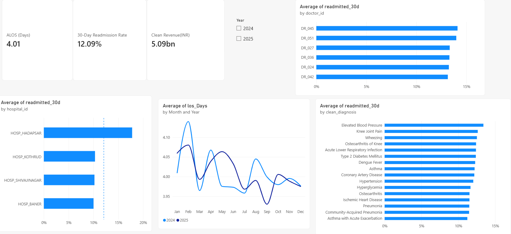
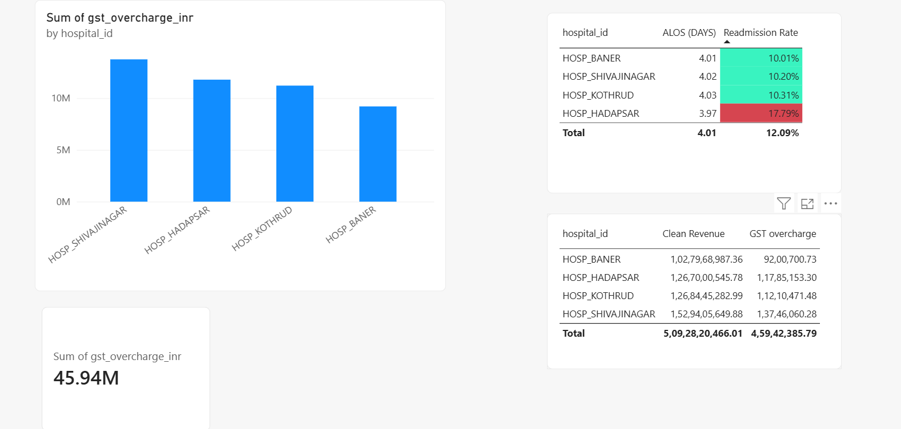

# Pune Hospital Network — KPI Review & Billing Audit (2024–2025)

## Executive Summary
I analyzed 500,000 operational and billing records across four Pune hospitals (Baner, Shivajinagar, Kothrud, and Hadapsar) in Power BI to evaluate clinical quality and audit billing accuracy. While overall network averages looked stable at first glance, facility-level breakdowns exposed a major readmission outlier at Hadapsar (17.79% vs. ~10% at peer hospitals) and a billing tax bug that double-charged GST at 36% instead of 18%, creating ₹4.59 Cr in overcharges.

---

## Dashboard Preview

### Page 1: Executive Overview, YoY Trends & Driver Analysis

### Page 2: Clinical RAG Scorecard & GST Billing Audit

---

## Data Cleaning & Modeling (Power Query)
Before building visuals, I audited the raw data across four fact tables (`admissions`, `billing`, `opd_visits`, `lab_tests`) and fixed three issues without dropping source rows:

* **Double-Counted GST (~6% of bills):** Flagged invoices with an effective tax rate above 20% (to avoid floating-point false positives on 18%), recalculated clean 18% GST, and isolated the exact rupee overcharge with 0.00% reconciliation variance.
* **Missing Discharge Dates (~4% of admissions):** Kept all 80,000 admission records intact but left `los_days` as null for open/incomplete stays so Power BI averages wouldn't get skewed downward.
* **Messy Diagnosis Text:** Mapped 28 inconsistent free-text diagnosis entries (e.g., `T2DM`, `sugar high`) to 7 standard ICD-10 codes using a lookup table and a Left Outer merge.
* **Star Schema:** Connected a continuous 2024–2025 `Calendar` table (`1:*`) to both clinical and billing tables for accurate Year-over-Year filtering, sorting months chronologically via `Month_Num`.

---

## Key Findings

| Metric | Network Result | Notable Breakdown |
| :--- | :--- | :--- |
| **Average Length of Stay (ALOS)** | 4.01 days | Hadapsar is lowest at 3.97 days; others sit at 4.01–4.03 days |
| **30-Day Readmission Rate** | 12.09% | Hadapsar: **17.79% (Red)** vs. Baner 10.01%, Shivajinagar 10.20%, Kothrud 10.31% |
| **Verified Clean Revenue** | ₹509.28 Cr | Split across Shivajinagar (₹152.94 Cr), Kothrud (₹126.84 Cr), Hadapsar (₹126.70 Cr), Baner (₹102.80 Cr) |
| **GST Overcharge Audited** | ₹4.59 Cr | Shivajinagar highest at ₹1.37 Cr, followed by Hadapsar (₹1.18 Cr), Kothrud (₹1.12 Cr), Baner (₹0.92 Cr) |

* **Premature Discharge Signal:** Hadapsar has the shortest stay (3.97 days) paired with the highest 30-day readmission rate (17.79%), suggesting patients may be getting discharged too early or without proper follow-up.
* **Bottom 10% Physician Cohort:** Ranking all 60 doctors isolated 6 clinicians (`DR_045`, `DR_051` at 15.50%, `DR_027`, `DR_056`, `DR_024`, `DR_042`) driving the highest readmission rates.

---

## Recommendations
1. **Patch the Billing ERP Tax Cap (Days 1–30):** Hard-cap hospital GST at 18% to block 36% calculation errors and run a credit-note audit on the ~6,000 affected bills (₹4.59 Cr exposure).
2. **Audit Hadapsar Discharge Protocols (Days 15–60):** Introduce a mandatory discharge checklist and a 7-day nurse follow-up call for high-risk chronic patients to bring Hadapsar closer to the ~10.2% peer benchmark.
3. **Targeted Peer Review for Bottom 10% Doctors (Days 30–90):** Pair the 6 highest-readmission physicians with Baner's top-performing team for monthly case reviews.
4. **Lock Down EMR Data Entry (Days 30–60):** Replace free-text diagnosis fields with ICD-10 dropdowns and require a discharge date before closing inpatient billing tickets.

---

## Files in This Repository
* `Pune_Hospital_KPI_Review.pbix` — Full Power BI Desktop file (Power Query transformations, Star Schema, and 2-page interactive dashboard).
* `Page1_Executive_Dashboard.png.png` & `Page2_Scorecard_Audit.png.png` — Static dashboard previews.
